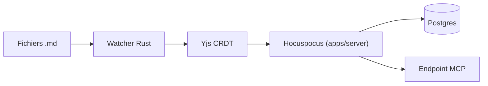

# naveedharri/baalda

> Application de notes en fichiers Markdown locaux, éditées en temps réel à plusieurs et par une IA.

## Le problème
Les outils de notes choisissent entre fichiers Markdown éditables par une IA et collaboration en temps réel.

## Ce que ça fait vraiment
Application de bureau Tauri v2 où chaque note est un fichier `.md` sur le disque. Un observateur de fichiers transforme les changements en opérations CRDT (Yjs, serveur Hocuspocus sur Postgres) pour la collaboration. Un agent local comme Claude Code édite les fichiers directement ; les agents distants passent par un point d'accès MCP avec les mêmes permissions que les humains.

## Comment c'est branché


## Essayer
```bash
cd app
pnpm install
cd apps/server
cp .env.example .env
pnpm run db:up
pnpm run migrate
pnpm run dev
pnpm run dev:desktop
```

## Coût et pièges
Node 22+, Rust, Docker pour Postgres. L'installateur Windows n'est pas signé. Un service géré payant existe sur baalda.com ; l'auto-hébergement est gratuit.

## Ce que ce n'est pas
Ce n'est pas encore éprouvé : le dépôt date de juillet 2026. Les chiffres de passage à l'échelle (millions de notes) sont des affirmations du README, non mesurées ici.

## Alternatives
Aucune alternative nommée dans le README (il évoque seulement 41 applications de type Obsidian comparées).

## Pour toi
À surveiller : la combinaison fichiers Markdown, MCP et collaboration est utile pour donner du contexte à tes agents, mais le projet est très jeune.

