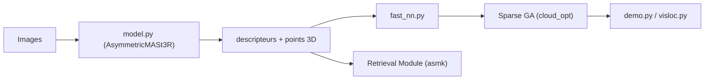

# naver/mast3r

> Official implementation of MASt3R: 3D-grounded image matching, for vision researchers.

## The problem
Classical image matching methods fail when the viewpoints are very different.

## What it actually does
The model predicts 3D points and descriptors for a pair of images, then derives 2D-2D correspondences from them (`fast_reciprocal_NNs`). A retrieval module and a sparse global alignment (MASt3R-SfM) handle larger scenes. The repository also contains visual localization (`visloc.py`), training and a Gradio demo.

## How it is wired


## Trying it
```bash
git clone --recursive https://github.com/naver/mast3r
conda create -n mast3r python=3.11 cmake=3.14.0
pip install -r requirements.txt
python3 demo.py --model_name MASt3R_ViTLarge_BaseDecoder_512_catmlpdpt_metric
```

## Cost and gotchas
CUDA GPU recommended, dust3r submodule and ASMK compilation. The weights are under CC-BY-NC-SA 4.0, with restrictive training datasets (Mapfree).

## What it is not
Not a production-ready reconstruction tool: the colmap/glomap scripts are poorly tested "toys". Commercial use of the weights is restricted.

## Alternatives
- DUSt3R: earlier model from which MASt3R derives.

## For you
Watch for research in 3D vision: good published results, but non-commercial license and the repository has had no commit since June 2025.
