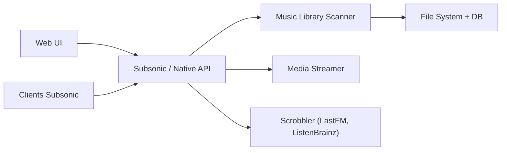

# navidrome/navidrome

> Self-hosted music streaming server, compatible with Subsonic clients.

## The problem
Listening to your own music collection remotely without depending on a streaming service.

## What it actually does
Indexes a large library, watches for changes, reads its metadata and streams almost any audio format with on-the-fly transcoding (Opus included). Multi-user (plays, playlists, favorites per person), synchronized lyrics, Material UI web interface, compatible with Subsonic/Madsonic/Airsonic. Binaries for Linux, macOS, Windows, Raspberry Pi, and Docker images. Cloud hosting offered through PikaPods.

## How it is wired

## Trying it
No command documented in the provided README; installation is on the project's website.

## Cost and gotchas
Free; PikaPods is a paid option. You must own the music files. GPL-3.0.

## What it is not
Not a streaming service with a catalog: it serves only your local library.

## Alternatives
No alternative named in the README.

## For you
Skip: home use unrelated to data or MLOps, except as an example of simple self-hosting.
