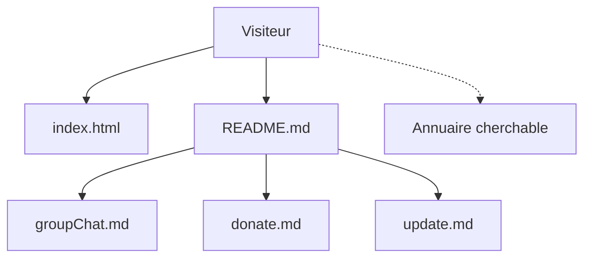

# naxiaoduo/1000UserGuide

> Annotated list of over 300 channels for presenting a product and finding its first users.

## The problem
An independent developer does not know where to promote their product to the first users.

## What it actually does
The README sorts sites by category: Chinese sites, Chinese directories and networks, Chinese forums, foreign sites, AI tool directories, site directories, foreign communities and Reddit subforums. Each entry says where to submit a product. A directory site searchable by tag exists separately. The README also contains advertising blocks for third-party tools.

## How it is wired


## Trying it
```bash
# Aucune commande : le dépôt est une liste à lire.
```

## Cost and gotchas
Free. The README admits that some sites have become inactive and points to an Excel workbook kept by a third party. Content mostly in Chinese. No license declared.

## What it is not
It is not a guarantee of visibility: each channel has its own rules, often paid or selective.

## Alternatives
No alternative named in the README.

## For you
Ignore: a product-promotion list, unrelated to data, AI or MLOps work.
