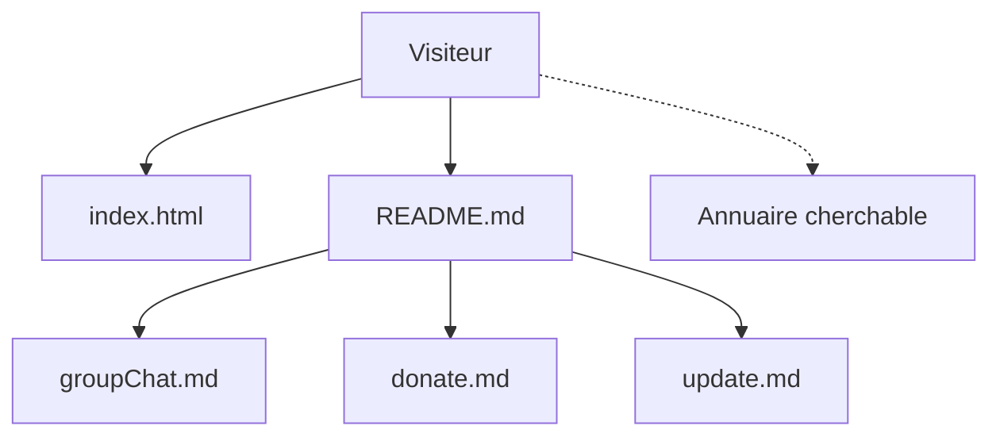

# naxiaoduo/1000UserGuide

> Liste commentée de plus de 300 canaux pour présenter un produit et trouver ses premiers utilisateurs.

## Le problème
Un développeur indépendant ne sait pas où promouvoir son produit auprès des premiers utilisateurs.

## Ce que ça fait vraiment
Le README classe des sites par catégorie : sites chinois, annuaires et réseaux chinois, forums chinois, sites étrangers, annuaires d'outils d'IA, annuaires de sites, communautés étrangères et sous-forums Reddit. Chaque entrée dit où soumettre un produit. Un site d'annuaire cherchable par étiquette existe à part. Le README contient aussi des encarts publicitaires pour des outils tiers.

## Comment c'est branché


## Essayer
```bash
# Aucune commande : le dépôt est une liste à lire.
```

## Coût et pièges
Gratuit. Le README admet que des sites sont devenus inactifs et renvoie à un classeur Excel tenu par un tiers. Contenu surtout en chinois. Aucune licence déclarée.

## Ce que ce n'est pas
Ce n'est pas une garantie de visibilité : chaque canal a ses règles, souvent payantes ou sélectives.

## Alternatives
Aucune alternative nommée dans le README.

## Pour toi
À ignorer : liste de promotion de produits, sans lien avec un travail data, IA ou MLOps.

