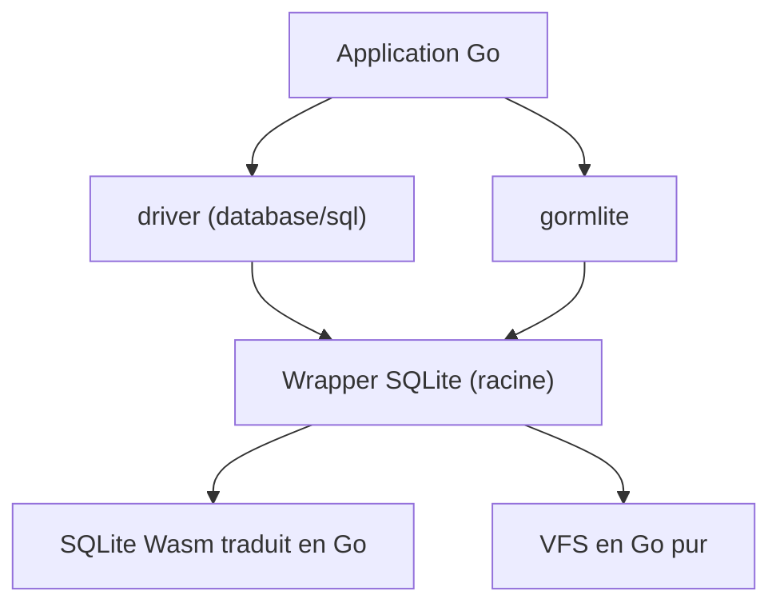

# ncruces/go-sqlite3

> Go binding for SQLite without cgo, via a Wasm build translated to Go.

## The problem
Using SQLite in Go often requires cgo, which complicates cross-compilation.

## What it actually does
Wraps a SQLite compiled to Wasm and translated to Go by wasm2go; only Go and `x/sys` are required. Provides a `database/sql` driver, the direct C API, a pure-Go VFS and a GORM driver. Includes incremental BLOB I/O, nested transactions, custom functions and virtual tables, online backup, JSON, encryption at rest, extensions.

## How it is wired


## Trying it
```go
import "database/sql"
import _ "github.com/ncruces/go-sqlite3/driver"

var version string
db, _ := sql.Open("sqlite3", "file:demo.db")
db.QueryRow(`SELECT sqlite_version()`).Scan(&version)
```

## Cost and gotchas
Free. Each connection runs in a Wasm sandbox: higher memory consumption. A connection must not be shared between goroutines.

## What it is not
Not a "native" SQLite: the VFS is replaced by a Go implementation, with limits depending on system/CPU (support matrix in the docs).

## Alternatives
The README mentions "alternatives" without naming them.

## For you
Worth watching: only useful if you write Go and want to avoid cgo; of no interest in Python.
