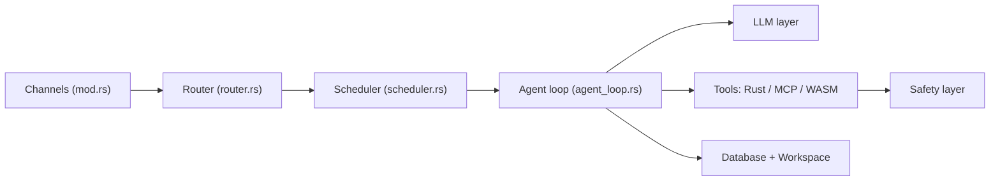

# nearai/ironclaw

> Self-hosted personal AI assistant in Rust, with a WASM sandbox and local encrypted storage, for security-conscious users.

## The problem
Personal assistants expose your data and secrets, and the third-party tools they run are not isolated.

## What it actually does
A binary installed via `ironclaw onboard`, which picks an LLM provider, stores the key in an encrypted vault and starts a service with a WebUI. Channels (REPL, HTTP, Telegram, Slack, Discord…) feed an agent loop that routes, schedules parallel jobs and calls Rust, MCP or WASM tools. Cron/event/webhook routines, hybrid full-text + vector memory. PostgreSQL persistence according to the described architecture.

## How it is wired


## Trying it
```bash
IRONCLAW_RELEASE_TAG=ironclaw-vX.Y.Z
curl --proto '=https' --tlsv1.2 -LsSf \
  "https://github.com/nearai/ironclaw/releases/download/${IRONCLAW_RELEASE_TAG}/ironclaw-installer.sh" | sh
ironclaw onboard
ironclaw status
```

## Cost and gotchas
An LLM provider API key is on you. The Docker sandbox is optional but required for strong job isolation. PostgreSQL appears in the architecture; the README does not clearly say whether it is mandatory at install. A `curl | sh` on a pre-release should be reviewed. 1,565 open issues.

## What it is not
A rewrite inspired by OpenClaw, not a full equivalent: parity tracking is in FEATURE_PARITY.md. The README claims there is no telemetry; I did not verify it in the code.

## Alternatives
- OpenClaw: the original TypeScript version, with Docker as isolation.

## For you
Worth watching: the security design (WASM, secret injection, allowlist) is of interest to an MLOps profile, but the volume of issues and the pre-releases suggest waiting.
