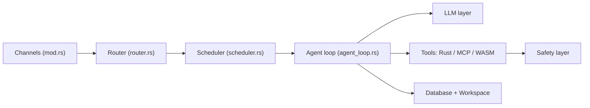

# nearai/ironclaw

> Assistant IA personnel auto-hébergé en Rust, avec sandbox WASM et stockage chiffré local, pour utilisateurs soucieux de sécurité.

## Le problème
Les assistants personnels exposent tes données et tes secrets, et les outils tiers qu'ils exécutent ne sont pas isolés.

## Ce que ça fait vraiment
Binaire installé via `ironclaw onboard`, qui choisit un fournisseur LLM, stocke la clé dans un coffre chiffré et démarre un service avec WebUI. Les canaux (REPL, HTTP, Telegram, Slack, Discord…) alimentent une boucle d'agent qui route, planifie des jobs parallèles et appelle des outils Rust, MCP ou WASM. Routines cron/événement/webhook, mémoire hybride plein texte + vecteurs. Persistance PostgreSQL d'après l'architecture décrite.

## Comment c'est branché


## Essayer
```bash
IRONCLAW_RELEASE_TAG=ironclaw-vX.Y.Z
curl --proto '=https' --tlsv1.2 -LsSf \
  "https://github.com/nearai/ironclaw/releases/download/${IRONCLAW_RELEASE_TAG}/ironclaw-installer.sh" | sh
ironclaw onboard
ironclaw status
```

## Coût et pièges
Clé d'API d'un fournisseur LLM à ta charge. Le sandbox Docker est optionnel mais requis pour l'isolation forte des jobs. PostgreSQL apparaît dans l'architecture ; le README ne dit pas clairement s'il est obligatoire à l'installation. Un `curl | sh` sur une préversion est à relire. 1 565 issues ouvertes.

## Ce que ce n'est pas
Réécriture inspirée d'OpenClaw, pas un équivalent complet : le suivi de parité est dans FEATURE_PARITY.md. Le README affirme l'absence de télémétrie ; je ne l'ai pas vérifié dans le code.

## Alternatives
- OpenClaw : version TypeScript d'origine, avec Docker comme isolation.

## Pour toi
À surveiller : la conception sécurité (WASM, injection de secrets, allowlist) intéresse un profil MLOps, mais le volume d'issues et les préversions invitent à attendre.

