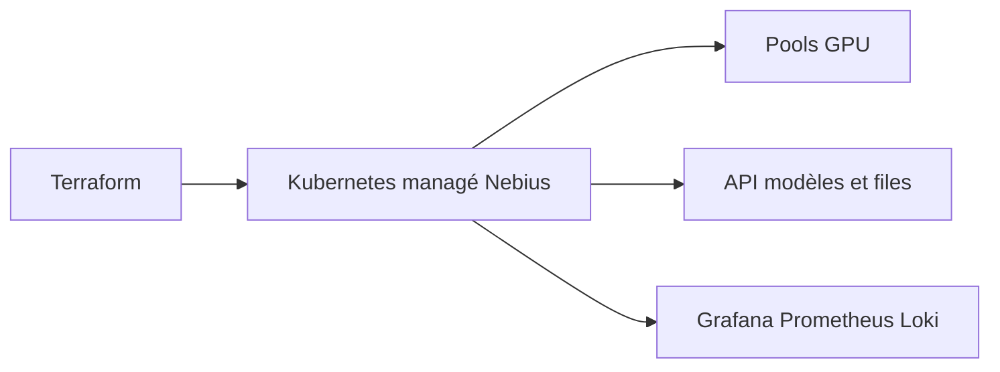

# nebius/nebius-solutions-library

> Terraform and Helm modules to deploy AI training and inference on the Nebius cloud.

## The problem
Setting up a GPU cluster with InfiniBand networking, a scheduler and inference tools by hand is long and fragile.

## What it actually does
A collection of solutions: training-ready Kubernetes (GPU-Operator, Network-Operator), SLURM, a multi-region inference fleet (spot, on-demand and reserved pools, single API, tenants with keys and budgets, observability), Wireguard, Bastion, Anyscale and SkyPilot integrations. Everything is driven by Terraform.

## How it is wired
Simplified diagram based on the sheet, no diagram provided.

## Trying it
No command documented in the README.

## Cost and gotchas
Nebius account and Nebius CLI required; cluster nodes are at your expense. The README announces about 45 minutes before the first call, after which updates and incidents are yours.

## What it is not
Not a managed service: Nebius Serverless AI is the no-operations version. The platform provides no model, only the infrastructure.

## Alternatives
- Nebius Serverless AI: managed service, online in a few minutes, nothing to operate.

## For you
Watch: relevant only if you have or are aiming for a Nebius cloud; otherwise it locks you into a provider.
