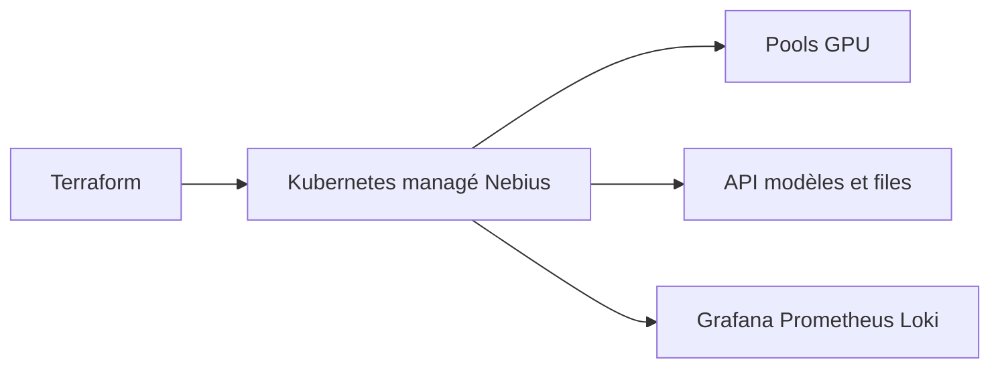

# nebius/nebius-solutions-library

> Modules Terraform et Helm pour déployer entraînement et inférence IA sur le cloud Nebius.

## Le problème
Monter un cluster GPU avec réseau InfiniBand, ordonnanceur et outils d'inférence à la main est long et fragile.

## Ce que ça fait vraiment
Collection de solutions : Kubernetes prêt pour l'entraînement (GPU-Operator, Network-Operator), SLURM, flotte d'inférence multi-région (pools spot, à la demande, réservés, API unique, locataires avec clés et budgets, observabilité), Wireguard, Bastion, intégrations Anyscale et SkyPilot. Tout se pilote par Terraform.

## Comment c'est branché
Schéma simplifié d'après la fiche, sans diagramme fourni.

## Essayer
Aucune commande documentée dans le README.

## Coût et pièges
Compte Nebius et CLI Nebius requis ; les nœuds de cluster sont à ta charge. Le README annonce environ 45 minutes avant le premier appel, puis les mises à jour et incidents sont à toi.

## Ce que ce n'est pas
Pas un service géré : Nebius Serverless AI en est la version sans exploitation. La plateforme ne fournit aucun modèle, seulement l'infrastructure.

## Alternatives
- Nebius Serverless AI : service géré, mise en ligne en quelques minutes, sans rien exploiter.

## Pour toi
Surveiller : pertinent seulement si tu as ou vises un cloud Nebius ; sinon il enferme dans un fournisseur.

