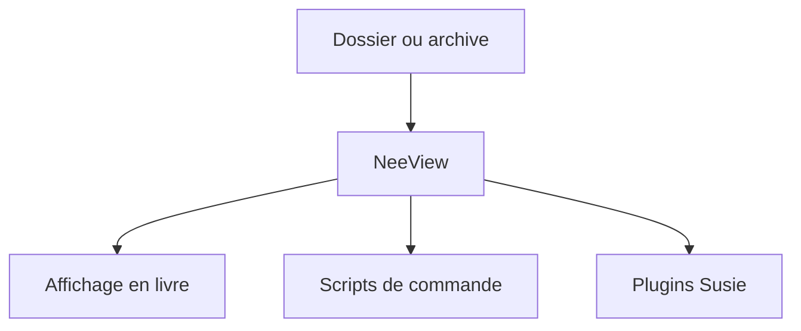

# neelabo/NeeView

> Windows image viewer that pages through folders and archives like a book, for readers of scans and comics.

## The problem
Browsing image pages stored in folders or in zip, rar or 7z archives forces you to extract everything or put up with a viewer poorly suited to reading.

## What it actually does
Opens folders and archives (even nested ones) like a book: bmp, jpg, gif, tiff, png, webp, PDF and video formats. Offers a magnifier, double-page mode, full screen, slideshow, mouse and touch gestures, customizable shortcuts and extension through scripts. Windows 10 64-bit minimum.

## How it is wired
Simplified diagram based on the sheet, no diagram provided.

## Trying it
No documented command: download from GitHub Releases, the Microsoft Store or Vector, then launch the application.

## Cost and gotchas
Free. Since v45.0 the installation is per user; a per-machine installation of v44.1 or earlier must be uninstalled first. The only official site is neelabo.github.io/NeeView; others should be avoided.

## What it is not
Not cross-platform: Windows only. Not a data or AI tool, it is an image-reading application.

## Alternatives
No alternative named in the README.

## For you
Ignore for a data, AI or MLOps profile: a Windows image viewer unrelated to your field, with a single maintainer.
