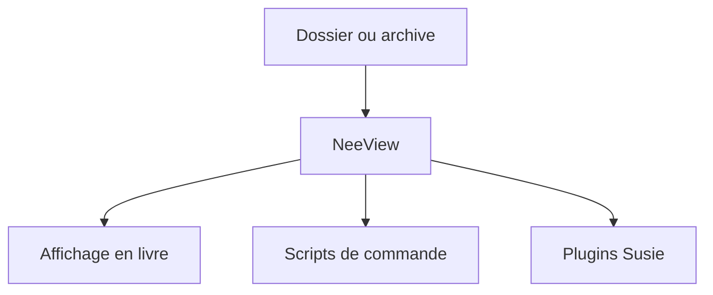

# neelabo/NeeView

> Visionneuse d'images Windows qui feuillette dossiers et archives comme un livre, pour lecteurs de scans et BD.

## Le problème
Parcourir des pages d'images rangées dans des dossiers ou des archives zip, rar ou 7z oblige à tout extraire ou à subir une visionneuse peu adaptée à la lecture.

## Ce que ça fait vraiment
Ouvre dossiers et archives (même imbriquées) comme un livre : formats bmp, jpg, gif, tiff, png, webp, PDF, vidéo. Propose loupe, mode double page, plein écran, diaporama, gestes souris et tactile, raccourcis personnalisables et extension par scripts. Windows 10 64 bits minimum.

## Comment c'est branché
Schéma simplifié d'après la fiche, sans diagramme fourni.

## Essayer
Aucune commande documentée : télécharger depuis GitHub Releases, le Microsoft Store ou Vector, puis lancer l'application.

## Coût et pièges
Gratuit. Depuis la v45.0 l'installation est par utilisateur ; une installation par machine v44.1 ou antérieure doit être désinstallée d'abord. Le seul site officiel est neelabo.github.io/NeeView, les autres sont à éviter.

## Ce que ce n'est pas
Pas multiplateforme : Windows seulement. Pas un outil de données ni d'IA, c'est une application de lecture d'images.

## Alternatives
Aucune alternative nommée dans le README.

## Pour toi
À ignorer pour un profil data, IA ou MLOps : lecteur d'images Windows sans rapport avec ton métier, et mainteneur unique.

