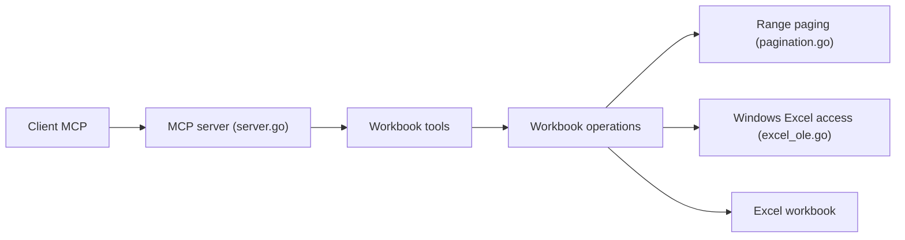

# negokaz/excel-mcp-server

> MCP server that reads and writes Excel files for AI assistants.

## The problem
An AI assistant cannot directly manipulate an Excel workbook: values, formulas, formats, sheets.

## What it actually does
Exposes seven tools via MCP over stdio: describe sheets, read (with pagination, formulas and styles), write, create a table, copy a sheet, format a range and, on Windows only, capture a screenshot of a sheet. Live editing is also reserved for Windows.

## How it is wired


## Trying it
```bash
npx --yes @negokaz/excel-mcp-server
```

## Cost and gotchas
Free. Node.js 20+. Read limit of 4000 cells by default (EXCEL_MCP_PAGING_CELLS_LIMIT). Last push in July 2025, 32 open issues.

## What it is not
Not a data analysis library: it does not compute. The richest features require Windows.

## Alternatives
No alternative named in the README.

## For you
Worth watching: useful to automate workbooks via an agent, but no activity for over a year; check that it holds up before relying on it.
