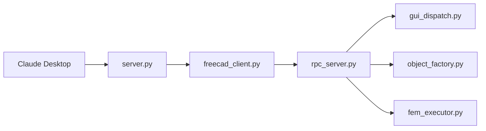

# neka-nat/freecad-mcp

> MCP server that lets Claude Desktop drive FreeCAD: models, Python scripts, inspection, FEM analyses.

## The problem
Modeling in CAD means manipulating the FreeCAD interface or writing scripts; an AI assistant cannot touch it without a bridge.

## What it actually does
Two processes: an MCP server (`server.py`) launched by the client via `uvx`, and a FreeCAD addon that hosts a local RPC server. The MCP client translates tool calls into RPC calls to the addon, which executes on the GUI thread (`gui_dispatch.py`). Validated object creation, Python script execution and FEM jobs all happen on the addon side. Connections are on `localhost` by default, with an IP filter.

## How it is wired


## Trying it
```bash
git clone https://github.com/neka-nat/freecad-mcp.git
cd freecad-mcp
```
Copy `addon/FreeCADMCP` into the FreeCAD addons folder, restart, run "Start RPC Server", then add to `claude_desktop_config.json`: command `uvx`, args `["freecad-mcp"]`.

## Cost and gotchas
Free; FreeCAD and uv/uvx required. FreeCAD must stay open with its RPC server started. Exposing the RPC beyond `localhost` is an explicit choice.

## What it is not
It is not a replacement for FreeCAD: it drives the open application. It runs Python inside FreeCAD, so it should not be opened to the network without precautions.

## Alternatives
- No alternative named in the README.

## For you
Worth watching: useful only if you do CAD with an assistant; outside your data/AI core, but the MCP bridge + local RPC pattern is instructive.
