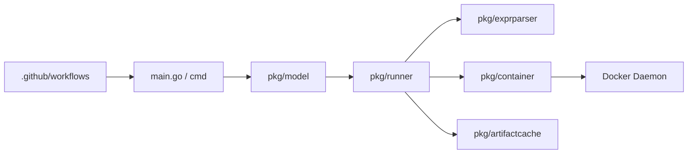

# nektos/act

> A command-line interface (CLI) that executes GitHub Actions workflows locally, within a Docker container, for a repository.

## The problem
To test a change to a `.github/workflows/` file, you need to commit and push, then wait for the runner to complete: this can lead to slow feedback loops.

## What it actually does
`act` script: `.github/workflows/`, determines the actions to run and their execution order based on dependencies, pulls or builds the necessary images using the Docker API, and then launches a container for each action with environment variables and a file system mirroring those of GitHub.

On the code side: `pkg/model` (workflows), `pkg/runner` (jobs and steps), `pkg/exprparser` (expressions `${{ }}`), `pkg/container` (Docker), `pkg/artifactcache` (cache and artifacts).

It also serves as a local task runner, replacing a `Makefile`.

## How it is wired


## Trying it
```bash
git clone git@github.com:nektos/act.git
make test
make install
```

## Cost and gotchas
Free, MIT license. Docker is required; the runner images to be downloaded or built consume disk and network space. Compilation: Go 1.20+.

## What it is not
This is not a CI service: everything runs on your own machine. The README does not detail the usage; it refers to an external user guide. The provided architecture analysis is generic.

## Alternatives
- GitHub Local Actions (VS Code extension) – to run `act` from the editor; it relies on `act`.

## For you
Ideal for debugging your ML CI pipelines without requiring multiple pushes.
