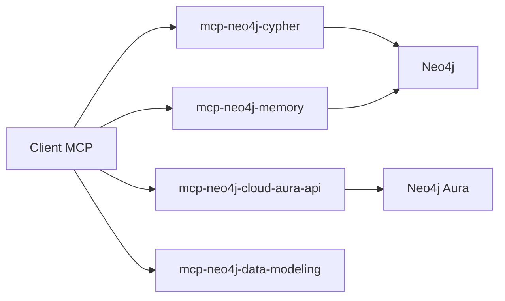

# neo4j-contrib/mcp-neo4j

> Neo4j Labs MCP servers to query, memorize and model Neo4j graphs from an AI assistant.

## The problem
An assistant needs to talk to a graph database, generate Cypher and keep a durable memory without integration code.

## What it actually does
Four servers: `mcp-neo4j-cypher` (schema and read/write queries; APOC required), `mcp-neo4j-memory` (knowledge graph), `mcp-neo4j-cloud-aura-api` (manage Aura instances) and `mcp-neo4j-data-modeling` (models, Arrows.app import/export). stdio, SSE and HTTP transports; containerized for ECS Fargate or Azure Container Apps.

## How it is wired


## Trying it
```bash
mcp-neo4j-cypher --transport http
mcp-neo4j-cypher --transport http --host 127.0.0.1 --port 8080 --path /api/mcp/
```

## Cost and gotchas
You need a Neo4j instance (or Aura, potentially paid). Labs program: "no SLA or backward compatibility guarantee". Letting an LLM write Cypher against a database is risky.

## What it is not
Not the product's official MCP server (the README points to that one). The generated diagram mentions an mcp-json-memory that is absent from the current list.

## Alternatives
The official Neo4j MCP server, cited by the README.

## For you
Worth watching: handy for GraphRAG or graph exploration via an assistant, with a caveat about the experimental status.
