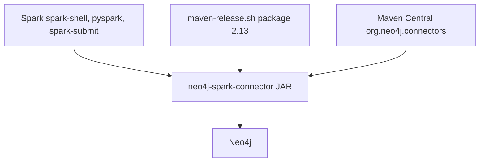

# neo4j/neo4j-spark-connector

> Official connector to read and write a Neo4j graph from Apache Spark.

## The problem
Connecting Spark to Neo4j requires custom read and write code and version management.

## What it actually does
A JAR to add to Spark (Scala 2.13, Spark 4.x since version 6.0.0). It comes as a full version (dependencies included) or a "thin" one to avoid classpath conflicts (Netty for example). The documentation is in the repository's `docs` folder. The details of reads and writes are not in the README.

## How it is wired
Simplified diagram based on the sheet, no diagram provided.



## Trying it
```bash
./maven-release.sh package 2.13
$SPARK_HOME/bin/spark-shell --jars neo4j-spark-connector-<version>-s_2.13.jar
$SPARK_HOME/bin/spark-shell --packages org.neo4j.connectors:spark:<version>-s_2.13
```

## Cost and gotchas
You need a Neo4j instance and Spark 4 with Scala 2.13: Java and Scala are not in the prerequisites list. Choose the right version using the compatibility table on the Neo4j site.

## What it is not
Not a database or a graph engine: only the bridge. Not compatible with Scala 2.12 since version 6.0.0.

## Alternatives
No alternative named in the README.

## For you
Adopt it if you move data between Spark and Neo4j: it is the official connector, maintained by the vendor.
