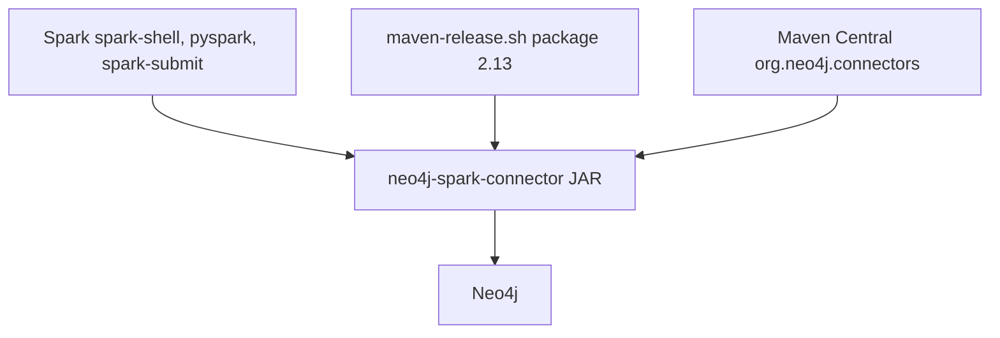

# neo4j/neo4j-spark-connector

> Connecteur officiel pour lire et écrire un graphe Neo4j depuis Apache Spark.

## Le problème
Brancher Spark sur Neo4j demande du code de lecture et d'écriture sur mesure et une gestion des versions.

## Ce que ça fait vraiment
Un JAR à ajouter à Spark (Scala 2.13, Spark 4.x depuis la version 6.0.0). Il existe en version complète (dépendances incluses) ou « thin » pour éviter les conflits de classpath (Netty par exemple). La documentation est dans le dossier `docs` du dépôt. Le détail des lectures et écritures n'est pas dans le README.

## Comment c'est branché
Schéma simplifié d'après la fiche, sans diagramme fourni.



## Essayer
```bash
./maven-release.sh package 2.13
$SPARK_HOME/bin/spark-shell --jars neo4j-spark-connector-<version>-s_2.13.jar
$SPARK_HOME/bin/spark-shell --packages org.neo4j.connectors:spark:<version>-s_2.13
```

## Coût et pièges
Il faut une instance Neo4j et un Spark 4 avec Scala 2.13 : Java et Scala ne sont pas dans la liste des prérequis. Choisir la bonne version selon la table de compatibilité du site Neo4j.

## Ce que ce n'est pas
Pas une base ni un moteur de graphes : seulement le pont. Pas compatible avec Scala 2.12 depuis la version 6.0.0.

## Alternatives
Aucune alternative nommée dans le README.

## Pour toi
Adopter si tu fais passer des données entre Spark et Neo4j : c'est le connecteur officiel, maintenu par l'éditeur.

