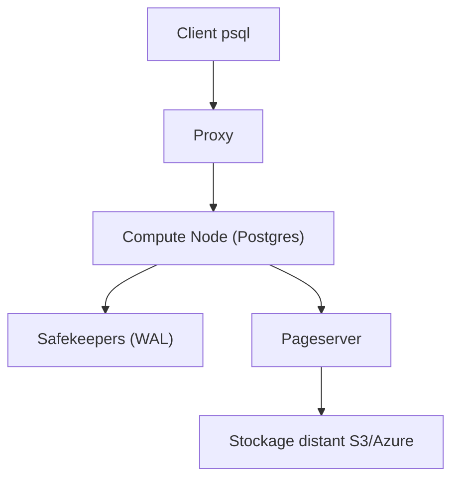

# neondatabase/neon

> Open source serverless Postgres platform that separates storage from compute, with data branches.

## The problem
A classic Postgres couples compute and storage: hard to scale, to suspend or to create fast copies of.

## What it actually does
Stateless Postgres compute nodes rely on a storage engine: the pageserver (scalable storage) and the safekeepers (redundant WAL service). Timeline branches create low-cost copies of data. A hosted free tier exists; otherwise you build and run it locally.

## How it is wired


## Trying it
```bash
git clone --recursive https://github.com/neondatabase/neon.git
cd neon
make -j`nproc` -s
cargo neon init
cargo neon start
cargo neon tenant create --set-default
cargo neon endpoint create main
cargo neon endpoint start main
psql -p 55432 -h 127.0.0.1 -U cloud_admin postgres
```

## Cost and gotchas
Free locally, but building requires Rust, protoc 3.15+ and many system packages. The hosted free tier is limited; beyond it, not documented here. The source path must not contain spaces.

## What it is not
Not a Postgres you install with one command: it is an architecture for operators. Running locally does not replace the hosted service.

## Alternatives
No named alternative in the README.

## For you
Watch: the free tier is enough for trials of feature or MLOps metadata databases; do not aim for self-hosting, too heavy.
