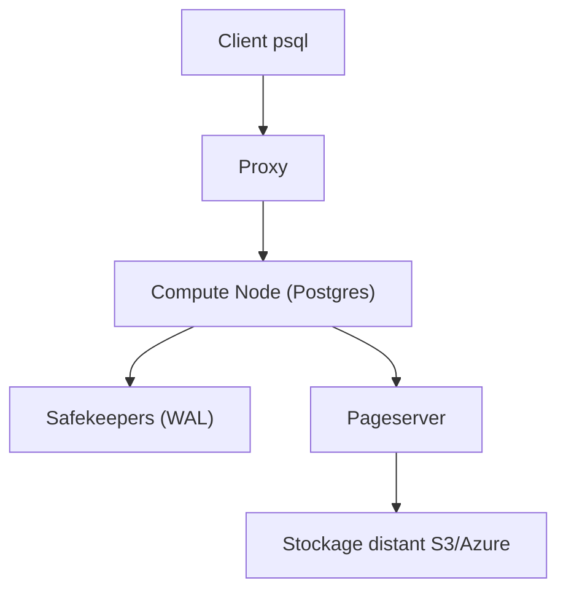

# neondatabase/neon

> Plateforme Postgres serverless open source qui sépare le stockage du calcul, avec branches de données.

## Le problème
Un Postgres classique lie calcul et stockage : difficile de le mettre à l'échelle, de le mettre en veille ou de créer des copies rapides.

## Ce que ça fait vraiment
Des nœuds de calcul Postgres sans état s'appuient sur un moteur de stockage : le pageserver (stockage extensible) et les safekeepers (service de WAL redondant). Les branches de timelines créent des copies de données à coût réduit. Une offre gratuite hébergée existe ; sinon on compile et lance en local.

## Comment c'est branché


## Essayer
```bash
git clone --recursive https://github.com/neondatabase/neon.git
cd neon
make -j`nproc` -s
cargo neon init
cargo neon start
cargo neon tenant create --set-default
cargo neon endpoint create main
cargo neon endpoint start main
psql -p 55432 -h 127.0.0.1 -U cloud_admin postgres
```

## Coût et pièges
Gratuit en local mais la compilation exige Rust, protoc 3.15+ et de nombreux paquets système. Offre gratuite hébergée limitée ; au-delà, non documenté ici. Le chemin des sources ne doit pas contenir d'espace.

## Ce que ce n'est pas
Pas un Postgres à installer en une commande : c'est une architecture pour opérateur. Le local ne remplace pas le service hébergé.

## Alternatives
Aucune alternative nommée dans le README.

## Pour toi
À surveiller : l'offre gratuite suffit pour des essais de bases de features ou de métadonnées MLOps ; ne pas viser l'auto-hébergement, trop lourd.

