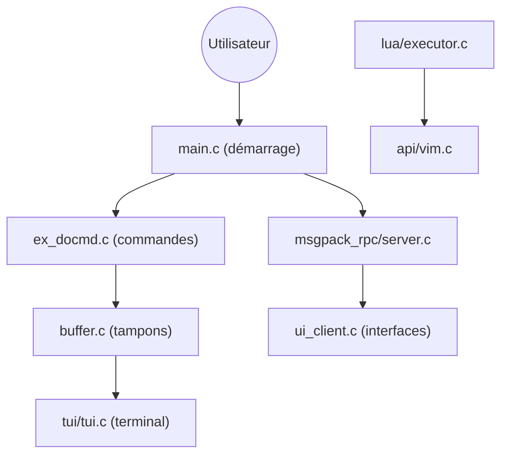

# neovim/neovim

> A modal text editor, a rework of Vim, extensible in Lua and drivable through an API, for working in the terminal.

## The problem
Vim is hard to maintain and extend: few alternative interfaces, an old scripting language, held-back contributions.

## What it actually does
An editor in C with a built-in terminal interface, an embedded terminal emulator, asynchronous jobs and state shared between instances (shada). An API accessible from many languages lets you plug in graphical interfaces without touching the core. Lua and Vimscript serve as scripting languages; most Vim plugins remain compatible.

## How it is wired


## Trying it
```bash
make CMAKE_BUILD_TYPE=RelWithDebInfo
sudo make install
```

## Cost and gotchas
Free. Prebuilt packages exist (Releases, Homebrew, Debian…); building requires CMake and its dependencies. The license is flagged "to verify" by GitHub; the README mentions Apache 2.0 except for code coming from Vim.

## What it is not
Not a ready-to-use IDE: the value comes from configuration and plugins. No new keybinding scheme: it keeps Vim's model.

## Alternatives
No alternative named in the README, apart from Vim, from which it derives.

## For you
Adopt if you work over SSH on compute machines: light, scriptable, installable everywhere.
