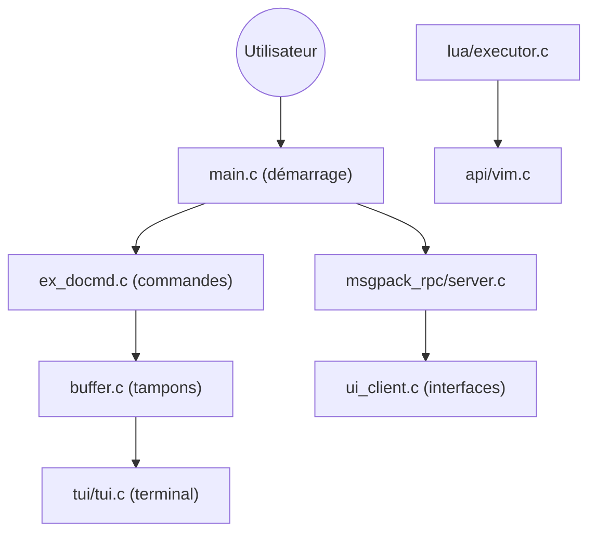

# neovim/neovim

> Éditeur de texte modal, refonte de Vim, extensible en Lua et pilotable par API, pour travailler au terminal.

## Le problème
Vim est difficile à maintenir et à étendre : peu d'interfaces alternatives, un langage de script ancien, des contributions freinées.

## Ce que ça fait vraiment
Éditeur en C avec interface terminal intégrée, émulateur de terminal embarqué, tâches asynchrones et état partagé entre instances (shada). Une API accessible depuis de nombreux langages permet de brancher des interfaces graphiques sans toucher au cœur. Lua et Vimscript servent de langages de script ; la plupart des plugins Vim restent compatibles.

## Comment c'est branché


## Essayer
```bash
make CMAKE_BUILD_TYPE=RelWithDebInfo
sudo make install
```

## Coût et pièges
Gratuit. Des paquets précompilés existent (Releases, Homebrew, Debian…) ; la compilation demande CMake et ses dépendances. La licence est signalée « à vérifier » par GitHub, le README parle d'Apache 2.0 sauf le code venu de Vim.

## Ce que ce n'est pas
Pas un IDE prêt à l'emploi : la valeur vient de la configuration et des plugins. Pas de nouveau schéma de raccourcis : on garde le modèle de Vim.

## Alternatives
Aucune alternative nommée dans le README, hormis Vim dont il est issu.

## Pour toi
À adopter si tu travailles en SSH sur des machines de calcul : léger, scriptable, installable partout.

