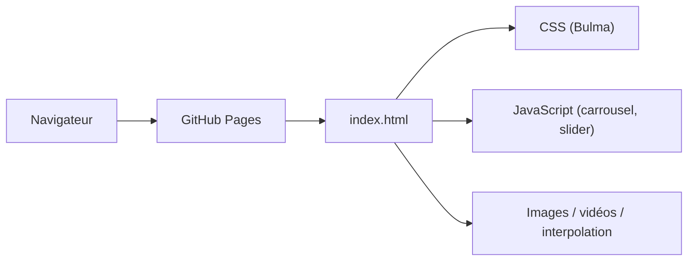

# nerfies/nerfies.github.io

> Source code of the website for the Nerfies research project (deformable neural radiance fields).

## The problem
Presenting a research paper with videos and interactive comparisons on a public page.

## What it actually does
The README contains only the repository description and the BibTeX citation of the ICCV 2021 paper. According to the diagram, it is a static site (`index.html`, Bulma CSS, JS carousels, images, videos, an `interpolation/` folder), with no backend and no model code.

## How it is wired


## Trying it
```bash
# Aucune commande documentée.
```

## Cost and gotchas
No cost. No license declared: reusing the page template is not clearly permitted. Last push on 2024-06-21.

## What it is not
It is not the Nerfies implementation nor a dataset: only the web page.

## Alternatives
No alternative named in the README.

## For you
Ignore: it is only a showcase page with no model code, and without a license you cannot safely reuse it as a template.
