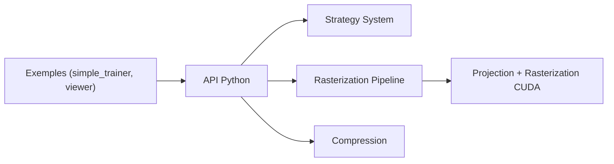

# nerfstudio-project/gsplat

> CUDA Gaussian rasterisation library with Python bindings, for 3D reconstruction by splatting.

## The problem
The official 3D Gaussian Splatting implementation consumes GPU memory and lacks features for experimentation.

## What it actually does
CUDA projection and rasterisation kernels called from PyTorch, with densification strategies (default, MCMC), compression, distributed training, varied cameras and sensors (fisheye, LiDAR), 3DGUT, and an experimental inference path (HiGS). The README claims to reproduce the official implementation's metrics with up to 4x less GPU memory and 15% less time.

## How it is wired


## Trying it
```bash
pip install gsplat
pip install git+https://github.com/nerfstudio-project/gsplat.git
python -m pip install -e .
cd examples
python -m pip install -r requirements.txt
bash benchmarks/basic.sh
```

## Cost and gotchas
Free. Install PyTorch first. Via PyPI, the CUDA code is compiled on first run; prebuilt wheels only for certain Python/torch/CUDA combinations. The main branch (v1.6.0, PyTorch 2.7+) is not yet on PyPI.

## What it is not
Not a capture application nor a turnkey tool: it is a building block to integrate. The HiGS inference path is experimental.

## Alternatives
No alternative named in the README (the official implementation serves as the reference).

## For you
Adopt if you work on Gaussian splatting with an NVIDIA GPU; off-topic otherwise.
