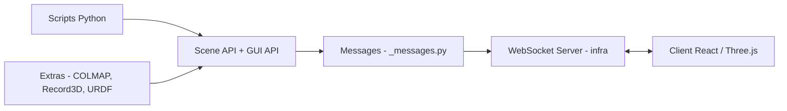

# nerfstudio-project/viser

> Python library for interactive 3D visualization for computer vision and robotics, with a web client.

## The problem
Visualizing point clouds, camera poses or 3D models from Python often requires a heavy interface that is hard to use remotely.

## What it actually does
A Python API draws 3D primitives, builds interface elements (buttons, sliders, fields), handles clicks, selections and transform gizmos, and controls the camera. The client is entirely web-based (React and Three.js), so it can be used over SSH. Server and client communicate over WebSocket with msgpack serialization. Additional viewers exist for COLMAP, Record3D and URDF.

## How it is wired


## Trying it
```bash
pip install viser            # Core dependencies only.
pip install viser[examples]  # To include example dependencies.
```

## Cost and gotchas
Free, no hardware prerequisite cited. The examples require additional dependencies (`viser[examples]`).

## What it is not
It is not a production rendering engine nor a statistical charting tool: it is an interactive 3D visualization tool.

## Alternatives
No alternative named in the README.

## For you
Adopt if you do 3D vision or robotics: simple pip installation and display in the browser, even on a remote server.
