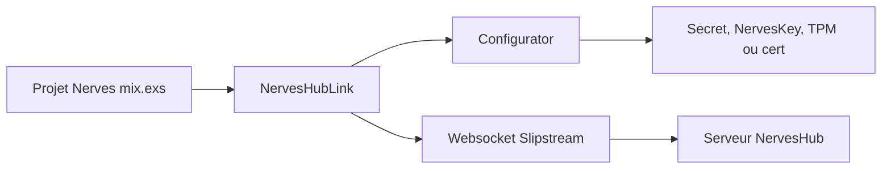

# nerves-hub/nerves_hub_link

> Elixir library that connects Nerves devices to NervesHub for firmware updates.

## The problem
A fleet of embedded devices must receive signed firmware and stay remotely observable, without physical intervention.

## What it actually does
Elixir client: the device opens a long-lived websocket to the NervesHub server. Supports firmware updates, a remote IEx console and health telemetry. Authentication by shared secret (hobbyist), NervesKey, TPM or local certificate. Images are signed and each device has a unique serial number.

## How it is wired


## Trying it
```elixir
# mix.exs
{:nerves_hub_link, "~> 2.2"}

# config
config :nerves_hub_link,
  host: "your.nerveshub.host",
  shared_secret: [product_key: "<product_key>", product_secret: "<product_secret>"]
```

## Cost and gotchas
Free, but you need a NervesHub server and a Nerves project (Elixir, absent from the list). License not declared in the catalog. One certificate per device in certificate mode.

## What it is not
Not a fleet management server: only the device-side client.

## Alternatives
No alternative named in the README.

## For you
Ignore: Elixir IoT firmware, unrelated to your data/AI/MLOps work.
