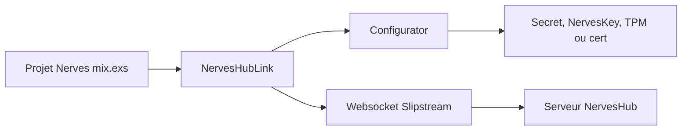

# nerves-hub/nerves_hub_link

> Bibliothèque Elixir qui connecte des appareils Nerves à NervesHub pour mises à jour de firmware.

## Le problème
Une flotte d'appareils embarqués doit recevoir des firmwares signés et rester observable à distance, sans intervention physique.

## Ce que ça fait vraiment
Client Elixir : le terminal ouvre un websocket long avec le serveur NervesHub. Prend en charge les mises à jour de firmware, une console IEx distante et la télémétrie de santé. Authentification par secret partagé (loisirs), NervesKey, TPM ou certificat local. Les images sont signées et chaque appareil a un numéro de série unique.

## Comment c'est branché


## Essayer
```elixir
# mix.exs
{:nerves_hub_link, "~> 2.2"}

# config
config :nerves_hub_link,
  host: "your.nerveshub.host",
  shared_secret: [product_key: "<product_key>", product_secret: "<product_secret>"]
```

## Coût et pièges
Gratuit, mais il faut un serveur NervesHub et un projet Nerves (Elixir, absent de la liste). Licence non déclarée dans le catalogue. Un certificat par appareil en mode certificat.

## Ce que ce n'est pas
Pas un serveur de gestion de flotte : seulement le client côté appareil.

## Alternatives
Aucune alternative nommée dans le README.

## Pour toi
À ignorer : firmware IoT Elixir, sans lien avec ton travail data/IA/MLOps.

