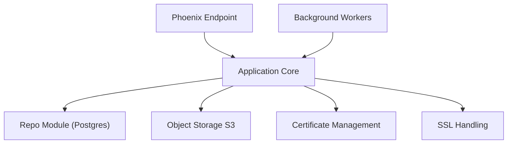

# nerves-hub/nerves_hub_web

> Open-source firmware update and fleet management platform for Nerves devices.

## The problem
Remotely updating thousands of embedded devices, authenticating them and signing the firmware, without hacking together your own server.

## What it actually does
- Distributes signed firmware to authenticated Nerves devices (hardware certificate or shared secret).
- Remote IEx terminal for debugging and recovery.
- Builds firmware deltas (fwup, xdelta3; detools for ESP-IDF) through background jobs.
- API documented with OpenAPI; advertised as reliable for hundreds of thousands of devices.

## How it is wired


## Trying it
```bash
docker compose up -d
mix setup
mix phx.server
# http://localhost:4000, compte de dev : nerveshub@nerves-hub.org / nerveshubweb
```

## Cost and gotchas
Free, self-hosted: application server, Postgres (18 recommended), S3-compatible storage and control of the SSL entry point. Elixir, Erlang and Node (versions in `.tool-versions`), plus `fwup` and `xdelta3`.

## What it is not
Not an MLOps model deployment tool: it targets Nerves device firmware. The 1.x branch is in very limited maintenance.

## Alternatives
No alternative cited in the README.

## For you
Ignore: very good for Nerves IoT fleets, but unrelated to your models or your data infrastructure.
