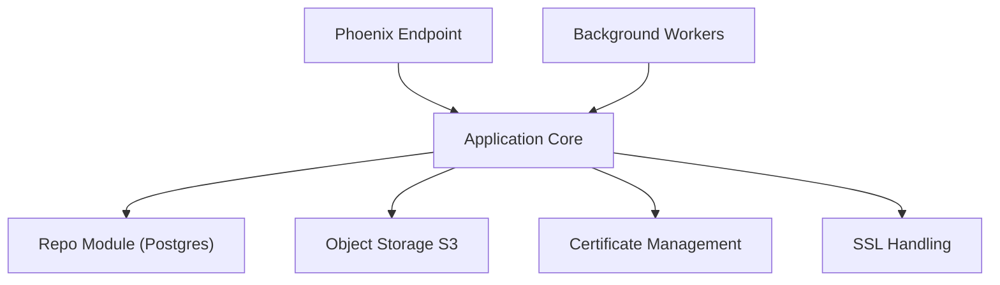

# nerves-hub/nerves_hub_web

> Plateforme libre de mise à jour de firmware et de gestion de flottes d'appareils Nerves.

## Le problème
Mettre à jour à distance des milliers d'appareils embarqués, en les authentifiant et en signant le firmware, sans bricoler son propre serveur.

## Ce que ça fait vraiment
- Distribue du firmware signé à des appareils Nerves authentifiés (certificat matériel ou secret partagé).
- Terminal IEx distant pour le débogage et la récupération.
- Construit des deltas de firmware (fwup, xdelta3 ; detools pour ESP-IDF) via des tâches de fond.
- API documentée avec OpenAPI ; annoncé fiable à des centaines de milliers d'appareils.

## Comment c'est branché


## Essayer
```bash
docker compose up -d
mix setup
mix phx.server
# http://localhost:4000, compte de dev : nerveshub@nerves-hub.org / nerveshubweb
```

## Coût et pièges
Gratuit, auto-hébergé : serveur d'application, Postgres (18 recommandé), stockage compatible S3 et maîtrise de l'entrée SSL. Elixir, Erlang et Node (versions dans `.tool-versions`), plus `fwup` et `xdelta3`.

## Ce que ce n'est pas
Pas un outil MLOps de déploiement de modèles : il vise le firmware d'appareils Nerves. La branche 1.x est en maintenance très limitée.

## Alternatives
Aucune alternative citée dans le README.

## Pour toi
À ignorer : très bon pour des flottes IoT Nerves, mais sans lien avec tes modèles ni avec ton infra data.

