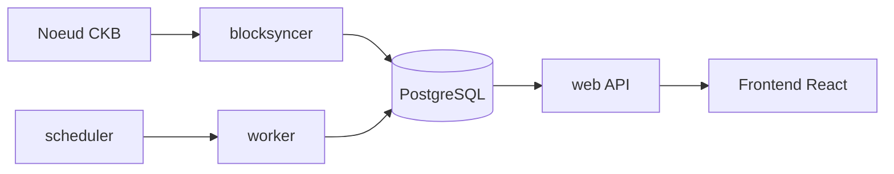

# nervosnetwork/ckb-explorer

> Rails server of the Nervos CKB blockchain explorer, for those who operate or browse this network.

## The problem
Reading blocks, transactions and addresses of a raw blockchain is impractical without an index and a search interface.

## What it actually does
Backend service that synchronizes CKB chain data, stores it in PostgreSQL and serves it through an API. Four processes (Procfile): web, worker, blocksyncer, scheduler. Web and worker scale out; blocksyncer and scheduler remain single-instance.

## How it is wired
Simplified diagram based on the sheet, no diagram provided.



## Trying it
```bash
cp .env.example .env
bin/setup
bundle exec rake db:create
bundle exec rake db:schema:load
bundle exec rails s
ruby lib/ckb_block_node_processor.rb
```

## Cost and gotchas
Free. Needs Ruby (absent from the list), PostgreSQL 14.3, Redis 6+, libsodium, secp256k1 and a CKB node.

## What it is not
Neither the CKB node nor the frontend: only the server. The old API documentation is flagged as obsolete.

## Alternatives
No alternative named in the README.

## For you
Ignore: blockchain explorer unrelated to data or AI.
