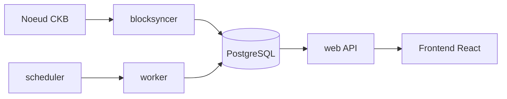

# nervosnetwork/ckb-explorer

> Serveur Rails de l'explorateur de la blockchain Nervos CKB, pour qui opère ou consulte ce réseau.

## Le problème
Lire blocs, transactions et adresses d'une blockchain brute est impraticable sans index et sans interface de recherche.

## Ce que ça fait vraiment
Service backend qui synchronise les données de la chaîne CKB, les stocke dans PostgreSQL et les sert par API. Quatre processus (Procfile) : web, worker, blocksyncer, scheduler. Web et worker passent à l'échelle ; blocksyncer et scheduler restent en instance unique.

## Comment c'est branché
Schéma simplifié d'après la fiche, sans diagramme fourni.



## Essayer
```bash
cp .env.example .env
bin/setup
bundle exec rake db:create
bundle exec rake db:schema:load
bundle exec rails s
ruby lib/ckb_block_node_processor.rb
```

## Coût et pièges
Gratuit. Besoin de Ruby (absent de la liste), PostgreSQL 14.3, Redis 6+, libsodium, secp256k1 et d'un noeud CKB.

## Ce que ce n'est pas
Pas le noeud CKB ni le frontend : seulement le serveur. L'ancienne documentation d'API est signalée obsolète.

## Alternatives
Aucune alternative nommée dans le README.

## Pour toi
À ignorer : explorateur de blockchain sans rapport avec la data ou l'IA.

