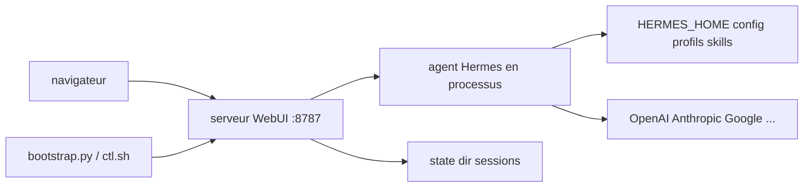

# nesquena/hermes-webui

> Dark web interface for the Hermes agent, at parity with its CLI, with no build step and no framework.

## The problem
A self-hosted agent running permanently on a server can only be driven over SSH from a terminal.
From a phone or a borrowed machine, that is uncomfortable, and the history is not readable.

## What it actually does
Three panels: sessions on the left, chat in the center, workspace file explorer on the right.
SSE streamed replies, tool-call cards, Mermaid rendering, collapsible reasoning blocks, approval of risky commands.
Tasks (cron), Skills, Memory (MEMORY.md, USER.md), Profiles, Todos and Spaces panels in the Control Center.
Optional authentication: password, WebAuthn passkeys, or native OIDC; signed 24-hour HMAC cookie.

## How it is wired


## Trying it
```bash
git clone https://github.com/nesquena/hermes-webui.git hermes-webui
cd hermes-webui
python3 bootstrap.py
```
As a daemon: `./ctl.sh start`, `./ctl.sh status`, `./ctl.sh logs --lines 100`, `./ctl.sh stop`.
Nix package: `nix shell github:nesquena/hermes-webui#default`.

## Cost and gotchas
It needs the Hermes agent installed (the bootstrap tries the official installer via `curl | bash`) and your
own provider keys. Native Windows is not supported by the bootstrap: Linux, macOS or WSL2.

## What it is not
Not an agent: it is a front end on hermes-agent, which runs in-process and reads `HERMES_HOME` directly.
Not a remote API client: `HERMES_API_URL` is only used for the cron health probe, it does not route the chat.
Not full agent-loop delegation: it is not shipped, it is tracked in an issue.

## Alternatives
`OpenClaw` — the competitor the README itself names as the closest, with a skills marketplace.
`OpenCode` — cited as the other project offering a self-hosted web interface.
`Claude Code` / `Codex CLI` — if you do not want persistent memory or self-hosted cron.

## For you
Only of interest if you already use hermes-agent; the README's comparison table is a sales pitch, read it as such.
