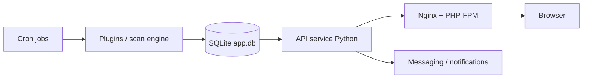

# netalertx/NetAlertX

> Self-hosted inventory of the devices on a network, with alerts on newcomers, for homelabs and IT teams.

## The problem
You do not know which devices are plugged into a network, nor when an unknown piece of hardware appears or disappears.

## What it actually does
Discovers devices (arp-scan, Pi-hole imports, DHCP, UniFi controller, SNMP router) and stores them in a local SQLite database. A Python backend exposes an API, GraphQL and SSE; a PHP interface behind nginx displays devices, events, presence. Workflows classify or clean up devices, and more than 80 services can receive notifications. Sync nodes report several sites back to a hub.

## How it is wired


## Trying it
```bash
docker run -d --network=host --restart unless-stopped \
  --cap-add=NET_RAW --cap-add=NET_ADMIN --cap-add=NET_BIND_SERVICE \
  -v /local_data_dir:/data -e PORT=20211 \
  ghcr.io/netalertx/netalertx:latest
git clone https://github.com/netalertx/NetAlertX.git
docker compose up --force-recreate --build
```

## Cost and gotchas
Free. Requires Docker with `--network=host` and elevated network capabilities, and you must back up `/data/config` and `/data/db`. The README recommends a reverse proxy with authentication. The compose file changed recently: read the migration guide.

## What it is not
Neither an infrastructure monitoring system nor a SIEM. Use it only on networks you are responsible for: it scans and keeps metadata about devices. GPL-3.0 license (copyleft).

## Alternatives
- Fing: commercial, proprietary application.
- NetBox: the reference for source of truth and IPAM.
- Zabbix or Nagios: infrastructure monitoring.

## For you
Adopt it for a homelab or a fleet where you want to know what connects: simple Docker installation, local data by default, active project.
