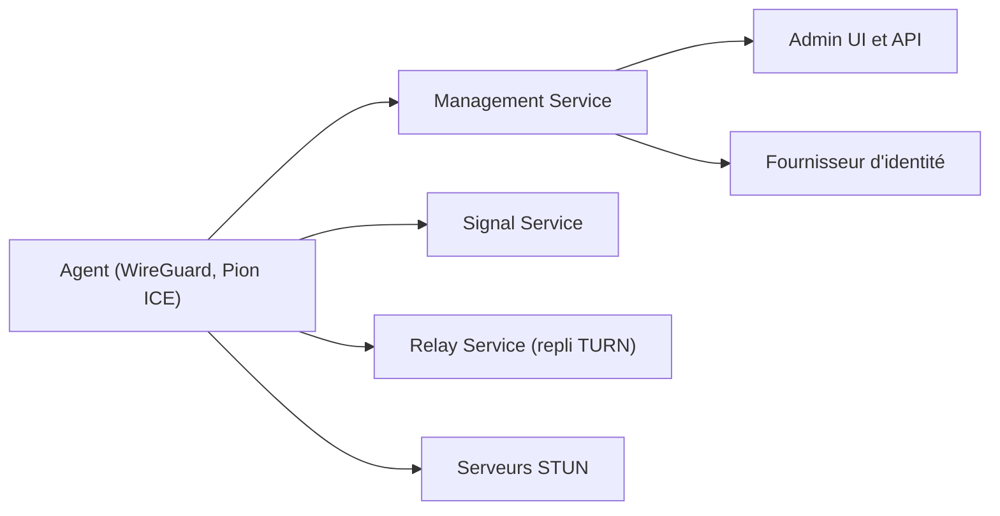

# netbirdio/netbird

> Zero-configuration WireGuard virtual private network with centralized access control, in the cloud or self-hosted.

## The problem
Connecting machines and sites without opening ports or managing VPN gateways and firewall rules is heavy and fragile.

## What it actually does
Each machine runs an agent that drives WireGuard, contacts the management service (IP, rules, updates) and negotiates the peer-to-peer connection via ICE/STUN and the signaling service; if that fails (strict NAT), a relay carries the traffic. Admin interface, SSO and MFA, groups and access rules, private DNS, routes to external networks, public API, Terraform and Ansible. Announced beta: network of AI agents.

## How it is wired


## Trying it
```bash
export NETBIRD_DOMAIN=netbird.example.com; curl -fsSL https://github.com/netbirdio/netbird/releases/latest/download/getting-started.sh | bash
```

## Cost and gotchas
Self-hosting: Linux VM with at least 1 CPU and 2 GB, TCP ports 80 and 443 and UDP 3478 open, a public domain name, Docker Compose v2. Cloud pricing is not specified in the README. The script is run by piping to bash.

## What it is not
It is not under a single license: BSD-3-Clause, except management/, signal/ and relay/ under AGPLv3. It does not replace a full perimeter firewall.

## Alternatives
No alternative cited in the README.

## For you
Keep an eye on it: relevant for privately linking GPU servers, notebooks and clusters, but the mixed AGPL license needs checking before integration.
