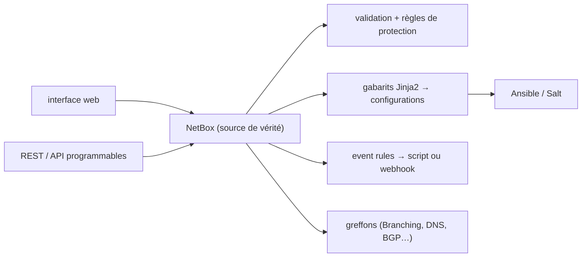

# netbox-community/netbox

> Source of truth for network infrastructure: IPAM and DCIM modeling, with programmable APIs.

## The problem
The intended state of a network lives in spreadsheets and in people's heads: cables, racks, VLANs, IP
addresses, circuits and power have no common model, hence no reliable automation.

## What it actually does
A ready-to-use, strongly interconnected data model (racks, devices, cables, IP addresses, VLANs,
circuits, power, VPN), exposed through a web interface and APIs. NetBox does not talk to devices: it
defines and validates the *intended* state, and makes it available to automation tools. Custom
fields, tags, plugins, granular permissions, custom validation and protection rules, Jinja2
configuration rendering retrievable through the API, custom scripts launchable from the UI, event
rules triggering a script or webhook, and a complete change log grouped by request ID.

## How it is wired

## Trying it
No command is documented in this README: it points to the public demo and the official
documentation.

## Cost and gotchas
Free in the Community version; NetBox Cloud and NetBox Enterprise are commercial offerings from the
same vendor. The README gives no prerequisites, no installation procedure and no license. The hidden
cost is the initial data entry: a source of truth is only valuable if exhaustive and kept up to date.

## What it is not
The README says so explicitly: NetBox does not interact with network devices, and rejects the
all-in-one tool stance. It is neither a monitoring system nor a deployment engine — the separation
of roles is claimed as an architectural choice.

## Alternatives
- NetBox Branching: plugin for working on isolated, mergeable branches.
- NetBox Custom Objects: plugin for defining new object types from the UI.
- NetBox Cloud / Enterprise: the hosted and commercial versions.

## For you
Off-topic for data, unless you need to pull a network inventory as a data source.
