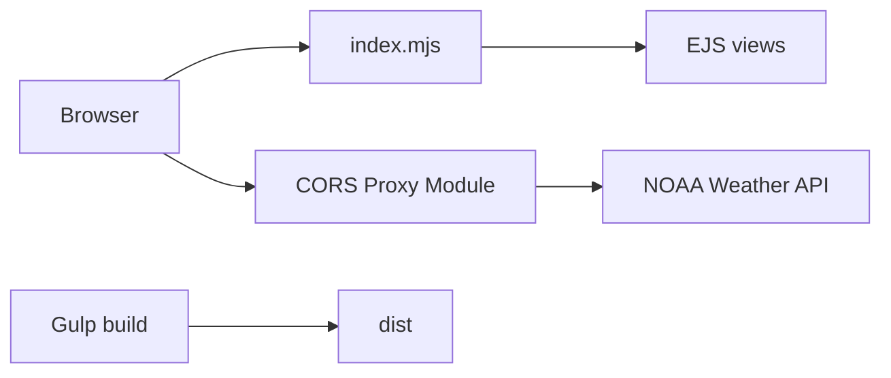

# netbymatt/ws4kp

> Nostalgic web simulation of the 1990s WeatherStar 4000 weather channel, powered by the NOAA API.

## The problem
Recapture the feel of a 1990s weather bulletin with current forecasts, without heavy configuration.

## What it actually does
A Node application (Express, EJS) serves an interface that chains screens: current conditions, local and extended forecasts, radar, hourly graph, SPC outlooks, almanac. It queries api.weather.gov, for the United States only. Two modes: server with a cache proxy, or static (nginx). Kiosk modes, permalinks, customizable music.

## How it is wired


## Trying it
```bash
git clone https://github.com/netbymatt/ws4kp.git
cd ws4kp
npm install
npm start
docker run -p 8080:8080 ghcr.io/netbymatt/ws4kp
```

## Cost and gotchas
Free. Depends on the NOAA API, sometimes down depending on the region. The README says not to use the site in dangerous weather situations.

## What it is not
Not a faithful replica of the WeatherStar hardware. Does not work outside the United States (an international variant is cited).

## Alternatives
The README cites ws4kp-international and the WS4000 Simulator.

## For you
Ignore: nostalgic entertainment, no data, AI or MLOps use; keep it for an ambient display.
