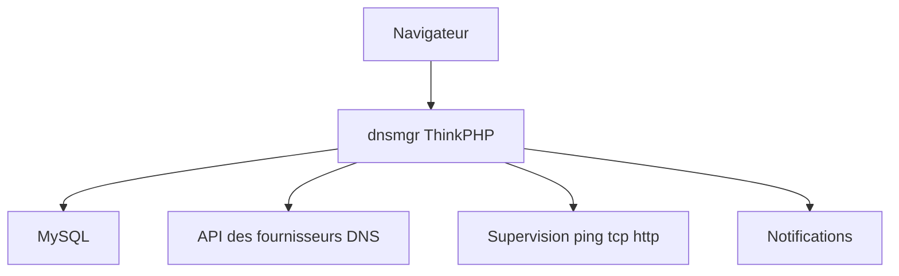

# netcccyun/dnsmgr

> PHP (ThinkPHP) web panel that manages DNS records from several providers from a single site.

## The problem
Domains are spread across several providers (Alibaba Cloud, Tencent, Cloudflare, AWS Route 53), each with its own interface.

## What it actually does
A single site drives the resolution settings of eleven platforms, with multi-user accounts and per-domain permissions, an API, automatic failover on outage (ping, tcp, http) and scheduled changes. It updates records with Cloudflare's optimized IPs, requests SSL certificates (Let's Encrypt) and deploys them, and notifies by e-mail, Telegram, DingTalk, Feishu and other channels. The README is in Chinese.

## How it is wired
Simplified diagram based on the sheet, no diagram provided.



## Trying it
```
docker run --name dnsmgr -dit -p 8081:80 -v /var/dnsmgr:/app/www netcccyun/dnsmgr
docker restart dnsmgr
```
The README also offers a `docker-compose` with MySQL 5.7.

## Cost and gotchas
Free, PHP 8.0 and MySQL 5.6 or later. The compose example sets the MySQL root password to `123456` and opens port 3306: change both. You need API access for each provider.

## What it is not
Not a DNS server: it answers no queries, it drives the providers' APIs. Documentation in Chinese only.

## Alternatives
No alternative named in the README.

## For you
Worth watching: only if you manage many zones across several providers; no direct link to data / AI / MLOps work.
