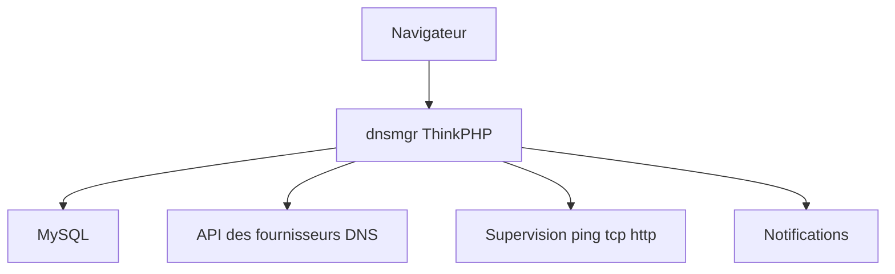

# netcccyun/dnsmgr

> Panneau web PHP (ThinkPHP) qui gère les enregistrements DNS de plusieurs fournisseurs depuis un seul site.

## Le problème
Les domaines sont répartis chez plusieurs fournisseurs (Alibaba Cloud, Tencent, Cloudflare, AWS Route 53) avec autant d'interfaces.

## Ce que ça fait vraiment
Un site unique pilote les résolutions de onze plateformes, avec comptes multi-utilisateurs et droits par domaine, une API, une bascule automatique sur panne (ping, tcp, http) et des changements planifiés. Il met à jour les enregistrements avec les IP optimisées de Cloudflare, demande des certificats SSL (Let's Encrypt) et les déploie, et notifie par e-mail, Telegram, DingTalk, Feishu et d'autres canaux. Le README est en chinois.

## Comment c'est branché
Schéma simplifié d'après la fiche, sans diagramme fourni.



## Essayer
```
docker run --name dnsmgr -dit -p 8081:80 -v /var/dnsmgr:/app/www netcccyun/dnsmgr
docker restart dnsmgr
```
Le README propose aussi un `docker-compose` avec MySQL 5.7.

## Coût et pièges
Gratuit, PHP 8.0 et MySQL 5.6 ou plus. L'exemple de compose fixe le mot de passe root MySQL à `123456` et ouvre le port 3306 : à changer. Il faut les accès API de chaque fournisseur.

## Ce que ce n'est pas
Pas un serveur DNS : il ne répond à aucune requête, il pilote les API des fournisseurs. Documentation uniquement en chinois.

## Alternatives
Aucune alternative nommée dans le README.

## Pour toi
À surveiller : seulement si tu gères beaucoup de zones chez plusieurs fournisseurs ; sans lien direct avec le travail data / IA / MLOps.

