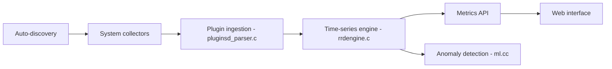

# netdata/netdata

> Real-time infrastructure monitoring agent, with machine learning for anomaly detection, for administrators and DevOps teams.

## The problem
Monitoring tools provide limited metrics, with low resolution, and are expensive to scale.

## What it actually does
An agent automatically discovers resources, collects metrics at a rate of one second, stores them locally (in a tiered time-series database), and trains an ML model for each metric to detect anomalies. It evaluates alerts, provides a web dashboard and API, exports to Prometheus/InfluxDB/Graphite, and can stream to a "parent" system. Netdata Cloud is optional.

## How it is wired

## Trying it
The README provides installation guides for different platforms (Linux, macOS, FreeBSD, Windows, Docker, Kubernetes) without requiring a command-line interface. The interface is accessible at `http://localhost:19999`. To disable telemetry, use the `--disable-telemetry` option in the installer.

## Cost and gotchas
Free agent; Cloud with a free offer. Defaults to using approximately 5% of CPU and 150 MB of RAM (figures from the README). Anonymous telemetry is enabled by default.

## What it is not
Not fully GPL: the interface (Netdata UI) is under a separate NCUL1 license, and Cloud is a proprietary offering. It is not a complete logging/tracing tool.

## Alternatives
- Prometheus + Grafana: The README compares them, but requires more configuration, but offers a standard ecosystem.

## For you
Things to watch out for: Useful for observing training or inference servers without configuration, but check the GPL/NCUL1 perimeter and disable telemetry before deployment.
