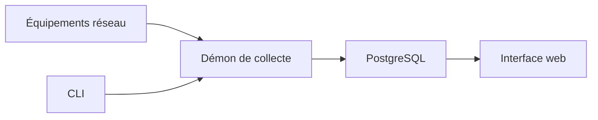

# netdisco/netdisco

> Web-based network management tool that locates machines and switch ports, for network administrators.

## The problem
Finding which switch port a machine is on and taking inventory of network hardware.

## What it actually does
Collects IP and MAC addresses into PostgreSQL via SNMP, CLI or device APIs. Lets you locate a machine, shut down a port, change VLAN or PoE, take inventory by model and operating system, and visualize the network. Perl and Python; lightweight web server, collection daemon, CLI, YAML configuration.

## How it is wired

## Trying it
No command documented in the README: installation is described on CPAN, and container images are available.

## Cost and gotchas
Free. Requires PostgreSQL and SNMP access to the devices.

## What it is not
Not a performance monitoring tool: it is an inventory and location tool.

## Alternatives
No alternative named in the README.

## For you
Ignore: network administration, outside your data/AI/MLOps profile.
