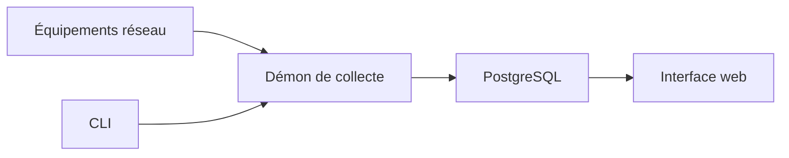

# netdisco/netdisco

> Outil web de gestion de réseau qui localise machines et ports de commutateurs, pour administrateurs réseau.

## Le problème
Retrouver sur quel port de commutateur se trouve une machine et inventorier le matériel réseau.

## Ce que ça fait vraiment
Collecte adresses IP et MAC dans PostgreSQL par SNMP, CLI ou API d'équipements. Permet de localiser une machine, éteindre un port, changer VLAN ou PoE, faire l'inventaire par modèle et système, visualiser le réseau. Perl et Python ; serveur web léger, démon de collecte, CLI, configuration YAML.

## Comment c'est branché

## Essayer
Aucune commande documentée dans le README : installation décrite sur CPAN, images de conteneur disponibles.

## Coût et pièges
Gratuit. Exige PostgreSQL et un accès SNMP aux équipements.

## Ce que ce n'est pas
Pas un outil de supervision de performance : un inventaire et localisation.

## Alternatives
Aucune alternative nommée dans le README.

## Pour toi
À ignorer : administration réseau, hors de ton profil data/IA/MLOps.

