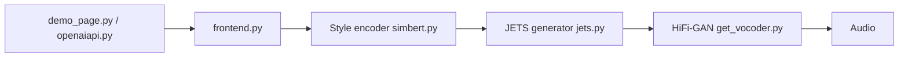

# netease-youdao/EmotiVoice

> English/Chinese text-to-speech engine with over 2000 voices, with prompt-driven emotion.

## The problem
Open-source TTS systems offer few voices and little control over the emotion of the generated speech.

## What it actually does
Converts text to phonemes, then to audio via a model conditioned on a style prompt and a speaker (JETS + HiFi-GAN vocoder in the code). Provides a Streamlit web interface, a batch script and an OpenAI-compatible API. Voice cloning has been announced since December 13, 2023.

## How it is wired


## Trying it
```bash
docker run -dp 127.0.0.1:8501:8501 syq163/emoti-voice:latest
pip install streamlit
streamlit run demo_page.py
uvicorn openaiapi:app --reload
```

## Cost and gotchas
The Docker image requires an NVIDIA GPU; manual installation requires downloading models (simbert, checkpoints) via git-lfs or ModelScope. Python 3.8 in the README.

## What it is not
Not a hosted service (the demo is on Replicate). English and Chinese only; Japanese/Korean remain "under development".

## Alternatives
No alternative named in the README.

## For you
Keep an eye on it: useful for prototyping expressive voice locally, but installation is heavy and the stack (Python 3.8) is aging.
