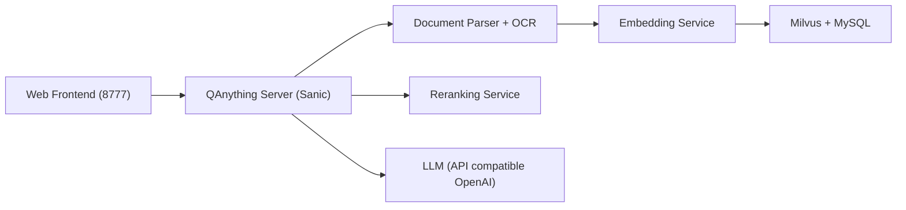

# netease-youdao/QAnything

> Local question-answering system over your own documents, with two-stage retrieval, installed via Docker Compose.

## The problem
Querying your own files (PDF, Word, spreadsheets, web pages) without sending your data to an external service.

## What it actually does
You drop files into a knowledge base; they are parsed (PDF with tables, OCR, Markdown, emails, CSV...), split into chunks, vectorized, then stored in Milvus. At question time, a first embedding search (BCEmbedding) is followed by a reranking step, before calling an LLM through an OpenAI-compatible interface (Ollama recommended locally). Modes: quick start, no-file, retrieval only, custom bots.

## How it is wired


## Trying it
```bash
git clone https://github.com/netease-youdao/QAnything.git
cd QAnything
docker compose -f docker-compose-linux.yaml up
docker compose -f docker-compose-linux.yaml down
```
Variants `docker-compose-mac.yaml` and `docker-compose-win.yaml`; interface at `http://localhost:8777/qanything/`.

## Cost and gotchas
Free. The README states a minimum of 20 GB of RAM and CPU operation. v2.0 no longer ships a local LLM: you must supply one (Ollama or an API), with the cost of a paid API if applicable. The README notes that answers with local Ollama are often weak. AGPL-3.0: sharing obligations if exposed over a network.

## What it is not
Not a model and not a full enterprise search engine. Audio recognition was removed in v2.0. Multi-GPU support has also disappeared.

## Alternatives
The README cites RAGFlow (parsing ideas) and Langchain-Chatchat (inspiration for the local knowledge base).

## For you
Worth watching: a ready-to-run local RAG with two retrieval stages, useful for comparing with your own stack, but heavy on RAM, AGPL, and dependent on an LLM supplied separately.
