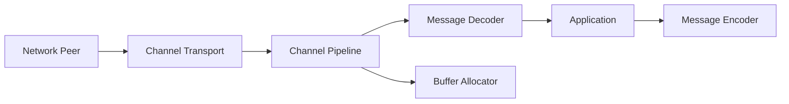

# netty/netty

> Asynchronous, event-driven Java framework for writing network servers and clients.

## The problem
Writing high-performance network servers in Java by hand is slow and error-prone.

## What it actually does
A channel pipeline processes transport events, decoders/encoders transform `ByteBuf`s, then application handlers respond. Buffer allocators, codecs and compression, TLS/ALPN, QUIC, DNS and SPDY. Netty 4.2 requires Java 8 or higher; `io_uring` transport is optional (Java 9).

## How it is wired

## Trying it
No command documented in the README (it points to the developer guide).

## Cost and gotchas
Free. To build: OpenJDK 8, Maven, and native development packages on Linux/macOS.

## What it is not
Not a ready-to-use HTTP server: it is a building library.

## Alternatives
No alternative named in the README.

## For you
Ignore for a data/AI profile: relevant only if you write Java network services yourself.
