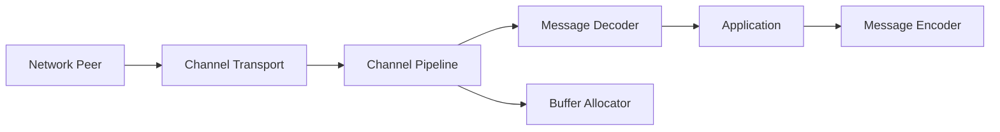

# netty/netty

> Framework Java asynchrone, piloté par événements, pour écrire des serveurs et clients réseau.

## Le problème
Écrire des serveurs réseau performants en Java à la main est long et source d'erreurs.

## Ce que ça fait vraiment
Un pipeline de canaux traite des événements de transport, les décodeurs/encodeurs transforment des `ByteBuf`, puis les gestionnaires applicatifs répondent. Allocateurs de tampons, codecs et compression, TLS/ALPN, QUIC, DNS et SPDY. Netty 4.2 exige Java 8 ou plus ; transport `io_uring` en option (Java 9).

## Comment c'est branché

## Essayer
Aucune commande documentée dans le README (renvoi vers le guide du développeur).

## Coût et pièges
Gratuit. Pour compiler : OpenJDK 8, Maven, et paquets de développement natifs sous Linux/macOS.

## Ce que ce n'est pas
Pas un serveur HTTP prêt à l'emploi : c'est une bibliothèque de construction.

## Alternatives
Aucune alternative nommée dans le README.

## Pour toi
À ignorer pour un profil data/IA : pertinent seulement si tu écris toi-même des services réseau Java.

