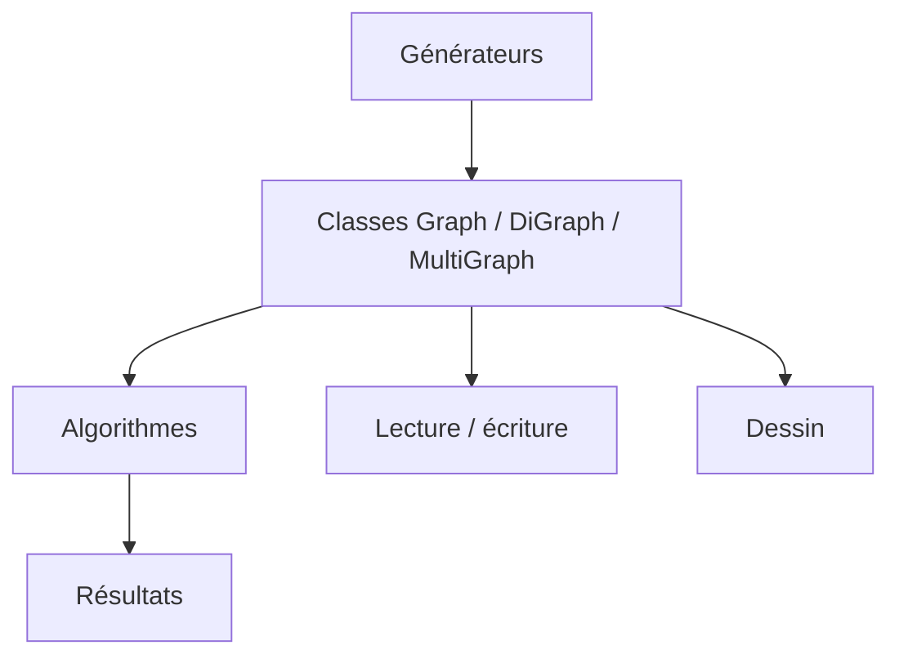

# networkx/networkx

> Python library for creating, manipulating and analyzing graphs and complex networks.

## The problem
Modeling relationships (social networks, dependencies, flows) and computing paths, centralities or communities without reimplementing the algorithms.

## What it actually does
Provides graph classes (simple, directed, multigraph), algorithms (shortest path, centrality, communities, flows, traversal), generators for classic or random graphs, reading/writing of formats (GraphML, GML, etc.) and drawing. According to the README, the license is BSD 3-clause, but it is not automatically recognized by GitHub. The architecture graph provided is a generic guide, not a reading of the code.

## How it is wired


## Trying it
```bash
pip install networkx
pip install networkx[default]
```
```python
import networkx as nx
G = nx.Graph()
G.add_edge("A", "B", weight=4)
nx.shortest_path(G, "A", "D", weight="weight")
```

## Cost and gotchas
Free. The README mentions optional dependencies (`default` extra). Very large graphs remain slow, since the implementation is pure Python, which the README does not state.

## What it is not
Not a graph database nor an advanced visualization tool.

## Alternatives
The README names none.

## For you
Adopt: the reference tool for graph theory in Python, useful in data analysis, knowledge graphs and pipelines.
