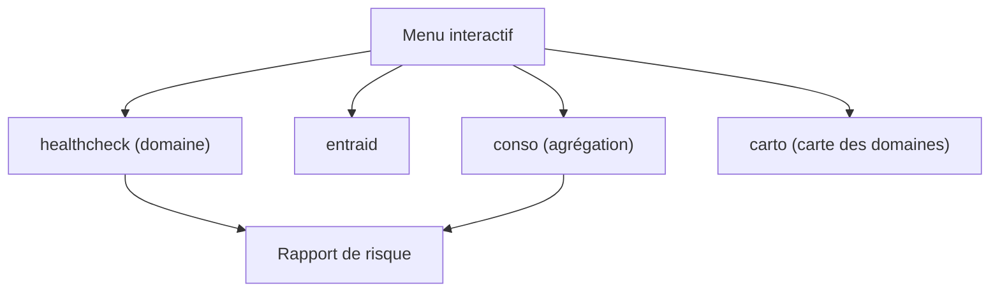

# netwrix/pingcastle

> Active Directory security audit tool that scores a domain's risk through a summary report.

## The problem
Assessing the security of an Active Directory by hand is slow; you want a quick and comparable snapshot.

## What it actually does
In interactive mode, it offers a healthcheck that scores a domain's risk, an Entra ID check, consolidation of several reports, a map of interconnected domains, checks on workstations, exports of users or computers and an advanced menu. It aims at "80% of critical issues in 20% of the time". The project is in C#.

## How it is wired
Simplified diagram based on the sheet, no diagram provided.

## Trying it
No precisely documented command: the program starts in interactive mode and accepts options such as `--help`.

## Cost and gotchas
Free open source edition; commercial editions exist at Netwrix. Built with Visual Studio 2012 to 2022. End of support announced for 2028-01-31. License present but not identified by GitHub.

## What it is not
Not an exploitation tool: it assesses, it does not compromise a directory. Not a continuous monitoring tool.

## Alternatives
No alternative cited in the README (mimikatz is mentioned as an example of threats).

## For you
Ignore: Active Directory audit reserved for Windows domain administrators, far from your data / AI / MLOps scope.
