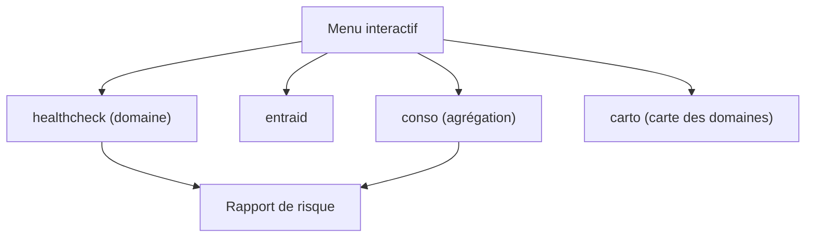

# netwrix/pingcastle

> Outil d'audit de sécurité Active Directory qui note le risque d'un domaine par un rapport synthétique.

## Le problème
Évaluer la sécurité d'un annuaire Active Directory à la main est long ; on veut un état des lieux rapide et comparable.

## Ce que ça fait vraiment
En mode interactif, il propose un healthcheck qui note le risque d'un domaine, un contrôle d'Entra ID, la consolidation de plusieurs rapports, une cartographie des domaines interconnectés, des vérifications sur postes, des exports d'utilisateurs ou d'ordinateurs et un menu avancé. Il vise « 80 % des problèmes critiques en 20 % du temps ». Le projet est en C#.

## Comment c'est branché
Schéma simplifié d'après la fiche, sans diagramme fourni.

## Essayer
Aucune commande documentée précisément : le programme démarre en mode interactif et accepte des options comme `--help`.

## Coût et pièges
Édition open source gratuite ; des éditions commerciales existent chez Netwrix. Compilation par Visual Studio 2012 à 2022. Fin de support annoncée au 2028-01-31. Licence présente mais non identifiée par GitHub.

## Ce que ce n'est pas
Pas un outil d'exploitation : il évalue, il ne compromet pas d'annuaire. Pas un outil de supervision continue.

## Alternatives
Aucune alternative citée dans le README (mimikatz est mentionné comme exemple de menaces).

## Pour toi
Ignorer : audit Active Directory réservé aux administrateurs de domaine Windows, loin de ton périmètre data / IA / MLOps.

