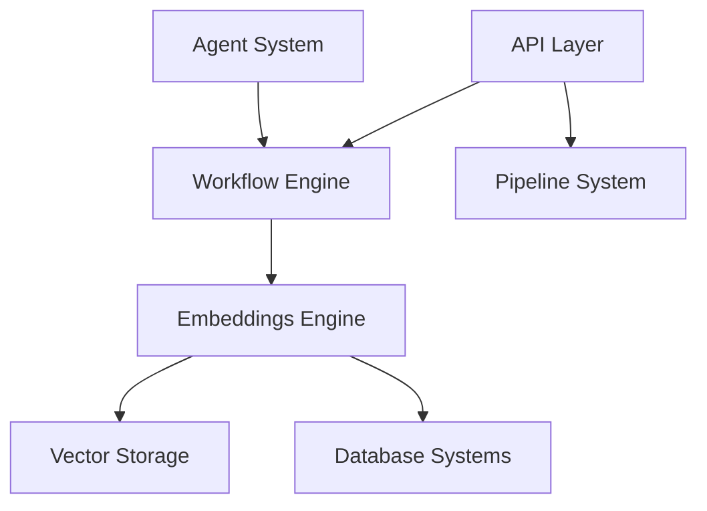

# neuml/txtai

> All-in-one Python framework for semantic search, RAG, agents and model workflows.

## The problem
Assembling a vector database, graph, relational database, model pipelines and an API forces you to glue several tools together.

## What it actually does
The core is an embeddings database that brings together vector indexes (dense and sparse), graphs and SQL. Around it: pipelines (LLM, question answering, transcription, translation, summarization), workflows to chain them, agents built on smolagents, and a web or MCP API. Runs locally, with Hugging Face Transformers and Sentence Transformers, models of any size, a light install then extensible. Over 70 example notebooks.

## How it is wired


## Trying it
```bash
pip install txtai
CONFIG=app.yml uvicorn "txtai.api:app"
curl -X GET "http://localhost:8000/search?query=positive"
```

## Cost and gotchas
Python 3.11+. Free locally; remote LLMs go through LiteLLM with a key at your expense. NeuML sells consulting and a hosted service (txtai.cloud), both optional.

## What it is not
Not a specialized vector database at massive scale nor a renowned autonomous agent framework: it is an integrated whole, simpler than modular.

## Alternatives
smolagents is the basis of its agents; no other alternative named in the README.

## For you
Adopt: a very good starting point for a local RAG or semantic search with little code.
