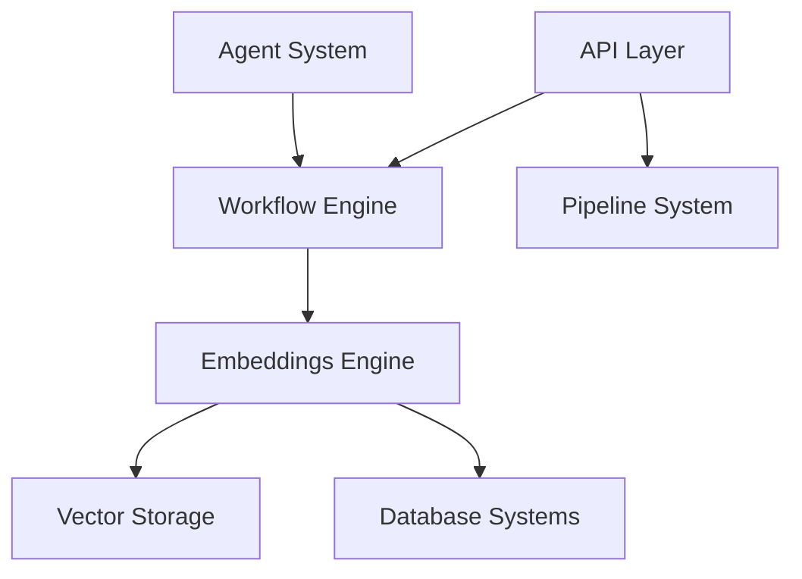

# neuml/txtai

> Framework Python tout-en-un pour la recherche sémantique, la RAG, les agents et les workflows de modèles.

## Le problème
Assembler base vectorielle, graphe, base relationnelle, pipelines de modèles et API oblige à coller plusieurs outils.

## Ce que ça fait vraiment
Le cœur est une base d'embeddings qui réunit index vectoriels (denses et épars), graphes et SQL. Autour : pipelines (LLM, questions-réponses, transcription, traduction, résumé), workflows pour les enchaîner, agents construits sur smolagents, et API web ou MCP. Fonctionne en local, avec Hugging Face Transformers et Sentence Transformers, des modèles de toute taille, installation légère puis extensible. Plus de 70 notebooks d'exemples.

## Comment c'est branché


## Essayer
```bash
pip install txtai
CONFIG=app.yml uvicorn "txtai.api:app"
curl -X GET "http://localhost:8000/search?query=positive"
```

## Coût et pièges
Python 3.11+. Gratuit en local ; les LLM distants passent par LiteLLM avec clé à ta charge. NeuML vend du conseil et un service hébergé (txtai.cloud), facultatifs.

## Ce que ce n'est pas
Pas une base vectorielle spécialisée à l'échelle massive ni un framework d'agents autonome réputé : c'est un ensemble intégré, plus simple que modulaire.

## Alternatives
smolagents est la base de ses agents ; aucune autre alternative nommée dans le README.

## Pour toi
À adopter : très bon point de départ pour une RAG ou une recherche sémantique locale avec peu de code.

